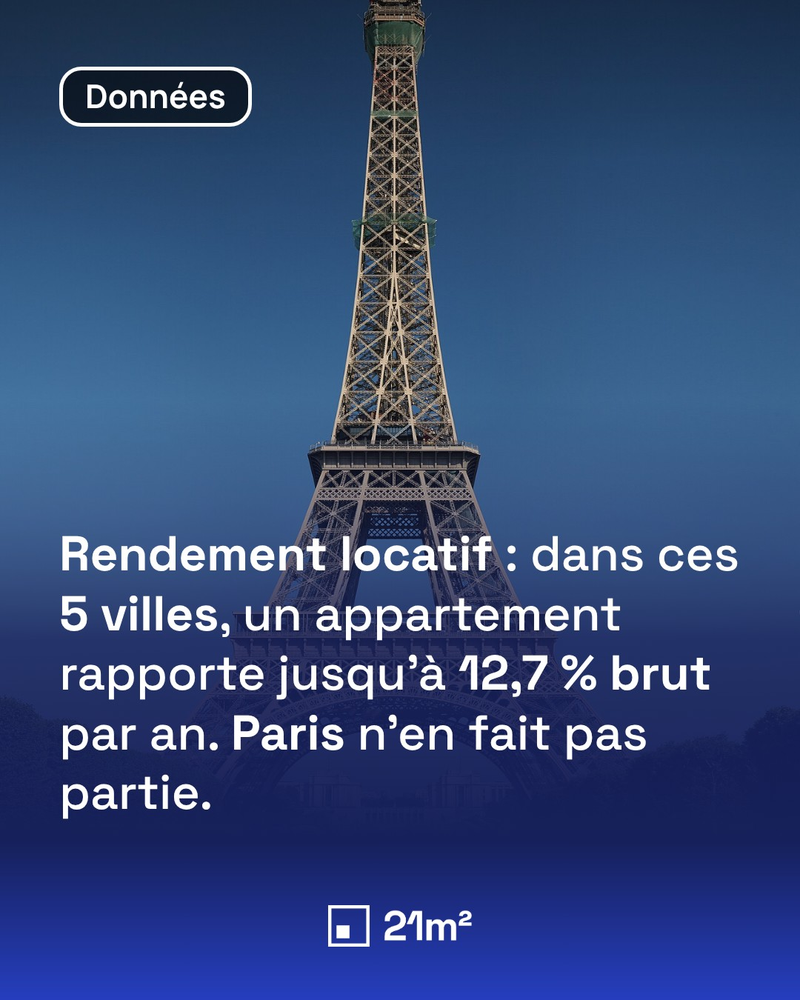
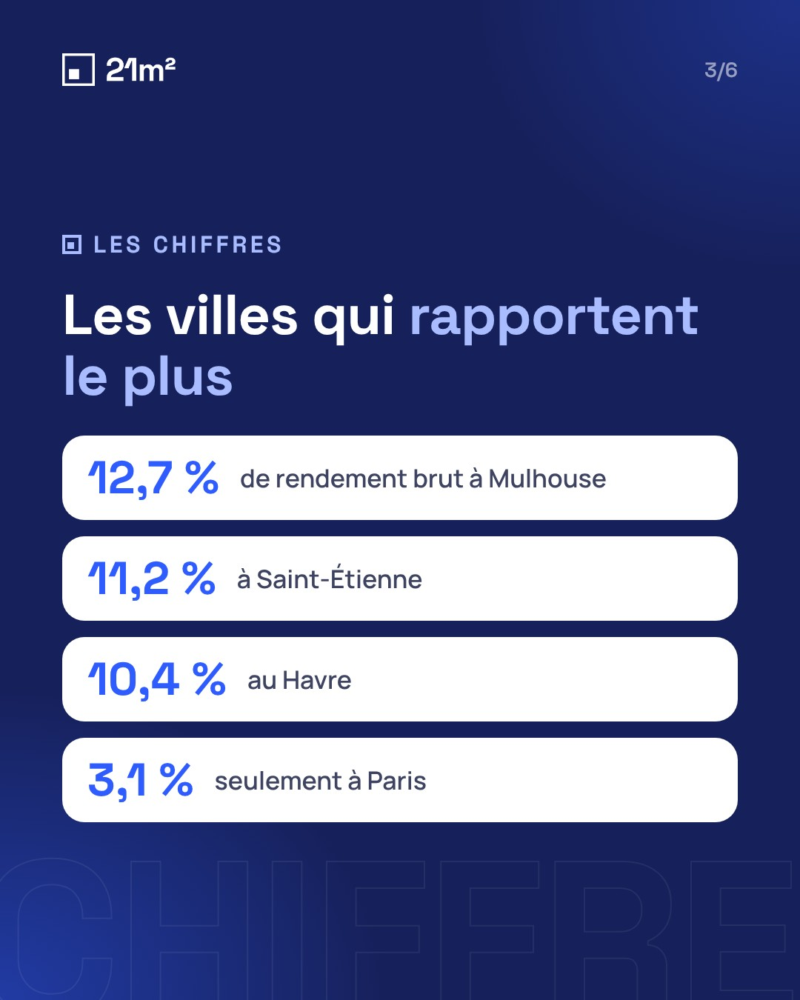

# 🎠 Carousels automatiques — Le média de l'investisseur & 21m2

Chaîne complète pour publier des carousels d'actualité chaque jour :

```
 Sites d'actu (RSS)  ──►  Collecte auto (toutes les 2 h)  ──►  📱 Notification sur le téléphone
                                                                     │  « ✅ Valider »
                                                                     ▼
 Images PNG + PDF + légende  ◄──  Rendu (template)  ◄──  Rédaction par Claude
          │
          └──►  Dashboard : « Enregistrer les images » → publication sur Instagram / LinkedIn
```

| Exemple — Le média de l'investisseur | Exemple — 21m2 |
|---|---|
|    |    |

## Comment ça marche au quotidien

1. **Toutes les 2 heures (6h–22h)**, l'horloge (workflow « Horloge ») lance la collecte qui lit les sites listés dans `config/sources.json`.
2. **Claude trie les actus** : note de 0 à 10 sur « est-ce que ça va faire réagir un public français ? », choix du compte, explication en une phrase et proposition d'accroche. Les actus internationales (TradingView, Zonebourse) sont filtrées sévèrement : on ne garde que ce qui parle aux Français (CAC 40, grandes marques, Bitcoin, BCE/Fed, épargne…).
3. Les actus notées **7/10 ou plus** déclenchent une **notification push** sur votre téléphone (appli gratuite **ntfy**) avec un bouton **✅ Valider**, dans la limite de 3 par collecte et 10 par jour pour chaque compte.
4. Le bouton ouvre le **dashboard** : vous choisissez le compte, ajoutez une consigne si besoin (« insister sur… »), et validez.
5. Environ 2 minutes plus tard, le carousel est prêt (nouvelle notification) : **6 à 8 slides PNG (1080×1350)**, un **PDF** (pour LinkedIn) et une **légende avec hashtags**.
6. Dans le dashboard, onglet **Prêts** : « 📲 Enregistrer les images » les envoie dans la pellicule, « 📋 Légende » copie le texte. Il ne reste qu'à publier.

Vous pouvez aussi transformer **n'importe quel article** en carousel avec le bouton **+ Article** du dashboard.

**Objectif : 2 à 5 carousels par jour et par compte.** Le dashboard affiche le compteur du jour. Une fois 5 carousels faits pour un compte, il ne reçoit plus de notifications ce jour-là. S'il en manque encore à 17h, vous recevez un rappel.

## Sources suivies

| Compte | Site | Thème |
|---|---|---|
| Le média de l'investisseur | Maddyness | French Tech, startups, levées de fonds |
| Le média de l'investisseur | TradingView News | marchés mondiaux, filtrés pour un public français |
| Le média de l'investisseur | Zonebourse | Bourse, filtrée pour un public français |
| 21m2 (+ LMI pour Moneyvox, qui couvre tout le site) | Moneyvox, Le Figaro Immobilier, Les Echos Patrimoine, Boursorama, Capital, Le Revenu | immobilier |

Pour chaque site, la collecte essaie les flux RSS connus, puis cherche le flux dans la page elle-même. En dernier recours, elle passe par Google News limité à ce site. La rubrique **État des sources** du dashboard montre quel site fonctionne et par quel moyen.

## Mise en route (≈ 10 minutes, une seule fois)

### 1. Fusionner ce code sur `main`
Les workflows planifiés et le dashboard tournent depuis la branche `main`.

### 2. Activer le dashboard (GitHub Pages)
*Settings → Pages → Build and deployment → Source : **GitHub Actions***. Lancez ensuite le workflow **Dashboard (GitHub Pages)** (onglet *Actions*). Le dashboard sera à :
`https://lemediadelinvestisseur.github.io/carousel/`

Sur iPhone : ouvrez-le dans Safari → Partager → **Sur l'écran d'accueil** pour l'avoir comme une appli.

### 3. Notifications sur le téléphone (ntfy)
1. Installez l'appli **ntfy** (App Store / Google Play).
2. Choisissez un nom de sujet **long et impossible à deviner** (ex. `carousel-lmi-7f3k9q2x`) — n'importe qui connaissant ce nom pourrait lire les notifications — puis abonnez-vous à ce sujet dans l'appli.
3. Dans GitHub : *Settings → Secrets and variables → Actions → New repository secret* : `NTFY_TOPIC` = votre nom de sujet.

### 4. Clé Claude (tri des actus + rédaction des carousels)
Créez une clé sur [console.anthropic.com](https://console.anthropic.com) puis ajoutez le secret `ANTHROPIC_API_KEY`.
Sans clé, le système fonctionne quand même, mais en mode dégradé : tri par mots-clés et carousels basiques (titre + résumé).

Modèle utilisé par défaut : `claude-opus-5-5` (modifiable via la variable `CLAUDE_MODEL`). Les éventuels refus du modèle sont automatiquement redirigés vers un modèle de secours (`fallbacks: "default"`), puis, en dernier recours, vers la version simplifiée.

### 5. Jeton GitHub pour valider depuis le téléphone
Le dashboard a besoin d'un jeton pour lancer la génération :
*github.com → Settings (de votre compte) → Developer settings → Personal access tokens → **Fine-grained tokens** → Generate new token*
- *Repository access* : **Only select repositories → carousel**
- *Permissions* : **Actions : Read and write**, **Contents : Read-only**

Collez-le dans le dashboard (⚙︎ Réglages). Il est stocké uniquement dans le navigateur de votre téléphone.

### 6. Premier test
*Actions → Collecte des actus → Run workflow*. Après ~1 minute, les actus apparaissent dans le dashboard et les notifications arrivent.

## Publication automatique sur Instagram et Facebook

Dans le dashboard, onglet **Prêts** → **🚀 Publier** : choisis Instagram et/ou la Page Facebook, puis :
- **🕒 Programmer** : date et heure (raccourcis 8 h, 12 h 30, 18 h, 21 h). Une « horloge » qui tourne en permanence publie à l'heure prévue (à 1 minute près) ; la carte affiche « 🕒 Programmé … » avec un bouton **Annuler**. En cas d'échec, une notification te prévient.
- **🚀 Publier maintenant**.
- **🧪 Test** : tout est préparé chez Meta, rien n'est publié.

### Configuration (une fois par marque)
Prérequis : le compte Instagram est un **compte professionnel** relié à la **Page Facebook** de la marque, et tu es administrateur de la Page.

1. Sur [developers.facebook.com](https://developers.facebook.com) → **Mes apps** → **Créer une app** (type **Entreprise**). Nom : `Carousels LMI`.
2. **Outils → Explorateur de l'API Graph** : choisis ton app, puis **Obtenir un jeton d'accès utilisateur** avec les autorisations `pages_show_list`, `pages_read_engagement`, `pages_manage_posts`, `instagram_basic`, `instagram_content_publish`, `business_management`. Dans la fenêtre Facebook, sélectionne la Page et le compte Instagram.
3. Clique sur l'icône **ⓘ** du jeton → **Ouvrir dans l'outil de jeton d'accès** → **Prolonger le jeton d'accès**, et copie le jeton longue durée.
4. De retour dans l'explorateur, colle ce jeton et lance la requête `me/accounts?fields=name,access_token,instagram_business_account`. Copie l'`access_token` de la Page : c'est un jeton **sans expiration**.
5. GitHub → **Settings → Secrets and variables → Actions** → secret `META_PAGE_TOKEN_INVESTISSEUR` (et `META_PAGE_TOKEN_21M2` pour 21m2).
6. **Actions → Publication réseaux sociaux → Run workflow**, mode **connexion** : chaque marque doit afficher ✓ avec sa Page et son compte Instagram.

Si les posts Facebook n'apparaissent pas publiquement, passe l'app en mode **Live** (Paramètres de l'app → Général) avec comme politique de confidentialité : `https://lemediadelinvestisseur.github.io/carousel/confidentialite.html`.

### Photos Unsplash (recommandé)
Unsplash fournit des photos professionnelles gratuites, idéales pour les villes et les monuments. Crée un compte sur [unsplash.com/developers](https://unsplash.com/developers) → **New Application** → copie l'**Access Key** dans le secret GitHub `UNSPLASH_ACCESS_KEY`. Sans clé, les autres sources d'images sont utilisées.

## LinkedIn : memes pour ton profil perso (projet séparé)

Les carousels vont sur Instagram et Facebook. LinkedIn est un projet à part : des **posts memes** créés de toutes pièces et publiés sur ton **profil personnel**. Tout se pilote depuis le même dashboard, bouton **💼 LinkedIn** en haut.

- **Chaque matin** (vers 7 h), 3 memes sont proposés et une notification arrive. Ils sont aussi disponibles à tout moment avec **✨ 3 nouvelles propositions**.
- **💡 Mon idée** (ou **+ Idée**) : tu écris une idée, Claude en fait un meme.
- Format de l'image : **meme connu** (Drake, Distracted boyfriend… avec le texte en français) ou **vraie photo** avec une légende au-dessus. Claude choisit, ou tu imposes le format.
- Sur chaque proposition : tu peux modifier le texte (💾), **🚀 Publier** maintenant ou **programmer**, **↻ Refaire** avec des consignes, ou **✕ Écarter**.
- Onglets : Propositions, En cours, Programmés, Publiés, Erreurs, Écartés.

Réglages dans `config/linkedin.json` :
- `about` : qui tu es ;
- `myInvestments` : tes investissements perso. Claude n'invente jamais de fait personnel, il utilise seulement ceux-là ;
- `topics` : les sujets ;
- `styleNotes` : ce qui marche chez les concurrents ;
- `postsPerDay` : nombre de memes par jour.

### Configuration LinkedIn (une fois)
1. Sur [developers.linkedin.com](https://developers.linkedin.com) → **My apps** → **Create app** : nom `Memes LinkedIn`, Page LinkedIn associée = l'une de tes Pages, logo au choix.
2. Onglet **Products** : demande **Share on LinkedIn** et **Sign In with LinkedIn using OpenID Connect**. Les deux sont accordés tout de suite.
3. **Docs and tools → OAuth Token Tools → Create token**, avec les autorisations `openid`, `profile` et `w_member_social`.
4. GitHub → **Settings → Secrets and variables → Actions** → secret `LINKEDIN_TOKEN`.
5. Dashboard → 💼 LinkedIn → **🔌 Vérifier la connexion** : ton nom doit s'afficher.

Le jeton expire au bout de **60 jours**. En cas d'erreur 401, génère-en un nouveau et remplace le secret.

### Statistiques LinkedIn : apprendre de ce qui marche
Dashboard → 💼 LinkedIn → onglet **📊 Stats**.

Le jeton de publication (`w_member_social`) **ne peut pas lire les statistiques** d'un profil perso. On utilise donc l'export officiel de LinkedIn :
1. Sur linkedin.com : **ton profil → Analytics → Impressions des posts** (linkedin.com/analytics/creator/content).
2. Période **365 jours** → **Exporter** (fichier `.xlsx`).
3. Dashboard → 📊 Stats → **📥 Importer l'export** et choisir le fichier. À refaire environ une fois par mois : les imports s'additionnent.

Le workflow **LinkedIn (statistiques)** lit le fichier (posts, impressions, engagements, abonnés, démographie), retrouve l'heure exacte de chaque post grâce à son identifiant, essaie de récupérer le texte des posts publics, puis **Claude analyse** ce qui marche (accroches, longueur, format de meme, jours et heures). Résultats : `data/linkedin-stats.json` et `data/linkedin-insights.json`. Les **règles de rédaction** et tes **meilleurs posts** sont ensuite donnés automatiquement à Claude à chaque nouveau meme. Une nouvelle analyse tourne aussi chaque lundi matin.

**Relevé automatique par l'API (facultatif).** LinkedIn propose l'API « Member Post Analytics » (produit **Community Management API**, autorisations `r_member_postAnalytics` et `r_member_profileAnalytics`), accordée sur dossier. Si LinkedIn te l'accorde, crée un jeton avec ces autorisations et ajoute-le dans le secret `LINKEDIN_STATS_TOKEN` : les memes publiés depuis le dashboard et le nombre d'abonnés seront relevés chaque semaine sans export.

> ⚠️ Le dépôt est public : les statistiques importées (chiffres des posts, démographie agrégée) y sont enregistrées et donc visibles.

## Personnaliser

| Quoi | Où |
|---|---|
| Sites d'actualité suivis | `config/sources.json` (flux RSS ; `brand` = `investisseur`, `21m2` ou `auto`) |
| Objectif quotidien, seuil et nombre de notifications | `config/sources.json` (`carouselsPerDay`, `notify`) |
| Critères de tri « ce qui fait réagir en France » | `scripts/lib/curate.mjs` |
| Couleurs, polices, ton éditorial, mots-clés, phrase d'appel à l'action | `config/brands.json` |
| Mise en page des slides | `templates/carousel.mjs` (puis `npm run examples` pour régénérer les exemples) |
| Consignes de rédaction données à Claude | `scripts/lib/writer.mjs` |
| Memes LinkedIn : profil, sujets, style | `config/linkedin.json` (consignes détaillées : `scripts/lib/memes.mjs`) |
| Lecture de l'export LinkedIn, consignes d'analyse | `scripts/lib/linkedin-stats.mjs` |
| Fréquence de collecte | `.github/workflows/collect.yml` (`cron`) |

Dans les textes, `**mot**` met le mot en couleur d'accent.

## En local

```bash
npm install
npx playwright install chromium
npm run demo                 # génère un carousel d'exemple dans carousels/
npm run collect              # collecte les actus
node scripts/generate.mjs --id <id>            # génère le carousel d'une actu
node scripts/generate.mjs --url https://...    # à partir d'un article
```

## Organisation du dépôt

```
config/          sources.json (sites), brands.json (identité des 2 comptes)
scripts/         collect.mjs, generate.mjs, publish.sh + lib/ (rss, rédaction, rendu, notifications)
templates/       carousel.mjs (template HTML des slides), demo.json
dashboard/       index.html (dashboard mobile, publié sur GitHub Pages)
data/news.json   la base des actus et de leur statut (mise à jour par les workflows)
carousels/       les carousels générés : AAAA-MM-JJ/<compte>-<titre>-<id>/
```

> ⚠️ Le dépôt est **public** : la liste des actus et les carousels générés sont visibles par tous. Les clés (Claude, ntfy, jeton GitHub) restent privées.
